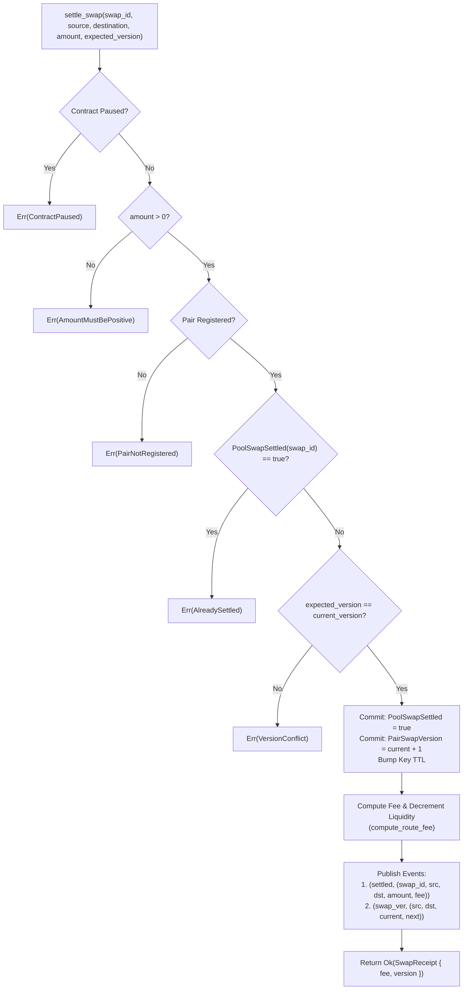

# Pool Swap Settlement Guard — Architecture & Runbook

Authoritative specification and operational runbook for the reentrancy and
double-application guard on the pool swap settlement path (Issue #455).

## Overview

When settlement execution occurs on-chain for routed swaps, the contract must
guarantee **exactly-once** settlement semantics. Without explicit settlement
guards:
1. The same swap could be submitted or processed multiple times (replay / double-application).
2. Malicious or reentrant external calls during fee computation or asset delivery
   could re-enter the settlement flow before accounting state is updated.

The settlement guard provides deterministic, atomic protection through:
- **Global Swap ID Identity**: Every settlement is identified by a unique `swap_id: u64`.
- **Pre-Execution Commitment**: The settlement flag (`PoolSwapSettled(swap_id)`) and
  the pair swap version (`PairSwapVersion(source, destination)`) are committed to
  persistent storage **before** computing fees, decrementing liquidity, or publishing
  external side-effects.
- **Fail-Fast Error Handling**: Attempts to replay a previously settled swap ID
  are rejected immediately with `SwapError::AlreadySettled` (error code `104`,
  `RouterError::AlreadySettled` code `24`).
- **Public Query View**: Integrators and off-chain watchers can verify settlement
  status via `is_swap_settled(swap_id)`.

---

## Architecture & Storage Layout

### Storage Keys

```rust
pub enum DataKey {
    // ...
    PairSwapVersion(Symbol, Symbol), // optimistic concurrency version per pair
    PoolSwapSettled(u64),            // once-only settlement flag per swap_id
}
```

- **Tier**: Persistent storage.
- **Key**: `DataKey::PoolSwapSettled(swap_id)`.
- **Value**: `bool` (`true` when settled, absent/`false` otherwise).
- **TTL Lifecycle**: Upon writing, the key is refreshed with `bump_key_ttl` to
  prevent premature archival of settlement records.

---

## Execution Invariants & Checks-Effects-Interactions

The settlement path strictly adheres to the Checks-Effects-Interactions pattern:



### Invariant Commit Order
1. **Pre-condition validation**: Validates contract pause state, positive amount,
   and active pair registration.
2. **Settlement non-existence**: Reads `DataKey::PoolSwapSettled(swap_id)`. If `true`,
   aborts immediately before performing any math or version checks.
3. **Optimistic concurrency match**: Verifies `expected_version == current_version`.
4. **State commitment before interactions**:
   - Stores `DataKey::PoolSwapSettled(swap_id) -> true`.
   - Stores `DataKey::PairSwapVersion(source, destination) -> current_version + 1`.
   - Refreshes TTL on persistent settlement key.
5. **Route accounting**: Invokes `compute_route_fee`, which debits bounded liquidity
   and updates route counts and metrics.
6. **Event emission**: Emits `settled` topic event followed by `swap_ver` transition event.

---

## Public Entrypoints

### `settle_swap`
```rust
pub fn settle_swap(
    env: Env,
    swap_id: u64,
    source: Symbol,
    destination: Symbol,
    amount: i128,
    expected_version: u64,
) -> Result<SwapReceipt, SwapError>
```
Executes guarded settlement for `swap_id`. Advances the pair swap version and
commits the once-only settlement flag.

### `settle_pool_swap`
```rust
pub fn settle_pool_swap(
    env: Env,
    swap_id: u64,
    source: Symbol,
    destination: Symbol,
    amount: i128,
    expected_version: u64,
) -> Result<SwapReceipt, SwapError>
```
Direct alias for `settle_swap`, guaranteeing full compatibility across pool swap
settlement naming conventions.

### `is_swap_settled`
```rust
pub fn is_swap_settled(env: Env, swap_id: u64) -> bool
```
Read-only query returning `true` if `swap_id` has already been settled, `false`
otherwise.

---

## Event Catalog

| Topic | Payload | Description |
|---|---|---|
| `settled` | `(swap_id: u64, source: Symbol, destination: Symbol, amount: i128, fee: i128)` | Emitted upon successful swap settlement |
| `swap_ver` | `(source: Symbol, destination: Symbol, old_version: u64, new_version: u64)` | Emitted when pair swap version advances |

---

## Error Taxonomy Mapping

| Enum | Code | Name | Description | Class |
|---|---|---|---|---|
| `SwapError::AlreadySettled` | `104` | `AlreadySettled` | Swap ID has already been settled | Safety |
| `RouterError::AlreadySettled` | `24` | `AlreadySettled` | Reentrancy / double-application rejection | Safety |

`RouterError::AlreadySettled` is non-retryable and classified under `ErrorClass::Safety`
because re-submitting an already settled swap is an illegal state transition.
